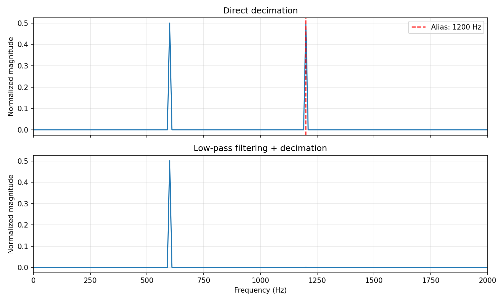

# 学习笔记 04（回顾）：重采样与混叠

> 对应代码：`dsp-toolbox/dsp_toolbox/resample.py`、`examples/demo_resample_aliasing.py`、`tests/test_resample.py`。这是对 DTMF 之前学习任务的回顾。

## 从采样率开始想

采样率 `fs` 表示每秒有多少个采样点；奈奎斯特频率是 `fs/2`。例如从 **12 kHz 抽取 3 倍**得到 **4 kHz**，输出只能无混叠地表示低于 **2 kHz** 的频率。所以抽取前要先压低 2 kHz 以上的成分，再每隔 3 点取 1 点。

仓库的演示信号同时包含 600 Hz 和 2800 Hz。直接抽取时，2800 Hz 在新的 4 kHz 采样率下折叠成 `|2800 − 4000| = 1200 Hz`。这不是原信号里真正的 1200 Hz，而是**混叠**。先低通再抽取，1200 Hz 假峰应明显变小。



运行 `python examples/demo_resample_aliasing.py` 可以重新生成这张图。

## 抽取和内插分别做什么

```text
抽取 M 倍：原采样率 fs  →  低通  →  每 M 点留 1 点  →  fs/M
内插 L 倍：原采样率 fs  →  插入 L−1 个零  →  低通  →  L·fs
```

插零只是在时间轴上留出新样本的位置，不会自动把它们变成合理的波形；后面的低通负责去掉插零产生的频谱镜像，并把新样本算出来。抽取和内插都需要低通，但一个主要防**混叠**，另一个主要去**镜像**。

对于 36 kHz → 24 kHz，最简比是 `up/down = 2/3`。若输入 18,000 点，输出点数约为 `ceil(18000 × 2 / 3) = 12000`，输出时间轴要用 **24 kHz** 生成。本项目的公开接口目前只实现整数倍 `decimate(x, M)` 和 `interpolate(x, L)`；这个 2/3 例子用于理解一般重采样过程，并不是当前公开接口的一步调用。

## 手写滤波器和延迟

`design_resample_filter` 先算理想低通的 sinc 系数，再乘 Hamming 窗，让无限长的理想滤波器变成有限长 FIR。当前抽取/内插使用 `20 × max(up, down) + 1` 个系数，因此长度总是**奇数**；系数围绕中心对称，中心下标是 `(len(h)−1)//2`。它把系数和归一化后再乘 `up`，补偿插零带来的幅度变化。

对这种奇数长度、对称系数的 FIR，线性相位延迟恰好是 `(len(h)−1)/2` 个**高采样率侧**的点。`resample_reference` 用 `q = center + down*m` 取第 `m` 个输出，正是为了对齐这段延迟。这个公式不能不加判断地套到偶数长度或任意非对称 FIR 上。

`filtered_sample` 在第 `q` 个高采样率位置求和，核心下标是：

```text
tap_index = q − k·up
y[q] += x[k] · h[tap_index]  （只在 tap_index 合法时）
```

它没有真的创建一条“插了零的大数组”，而是直接从原输入 `x[k]` 找到会贡献到当前位置的滤波器系数。

## 多相分解到底省了什么

如果内插 4 倍，每个输入点对应 4 个输出位置。朴素实现若对每个输出都扫描全部滤波器系数，会做许多“系数乘以插入的零”的无用计算。多相思路是按输出位置的余数，把滤波器系数分成 4 组；各组只与真正的输入样本相乘，最后把 4 路结果交错排列。

例如 4 个输出、每个都扫 20 个系数，朴素方法约要 `4 × 20 = 80` 次乘法；若每一路只碰自己的约 5 个有效系数，总计约 `4 × 5 = 20` 次。这里省的是**与零相乘的工作**，不是“把乘法变成加法”。实际次数还取决于边界、滤波器长度和具体实现。

当前 `filtered_sample` 已经按有效输入范围循环，避免了显式插零；但代码**没有**单独预先拆出多相系数数组，也没有做低采样率侧的性能基准。可以把它看作帮助理解多相索引的参考实现。

## 怎样验收

`tests/test_resample.py` 使用 SciPy 的 `firwin` 和 `resample_poly` 分别核对滤波器系数与输出，并检查不同输入长度、抽取/内插倍数、非法参数以及输入不被修改。数值对拍的目标是误差小于 `1e-10`。测试通过说明**这些条件下**的输出与参照一致；频谱图则另外说明为什么抽取前低通是必要的。
