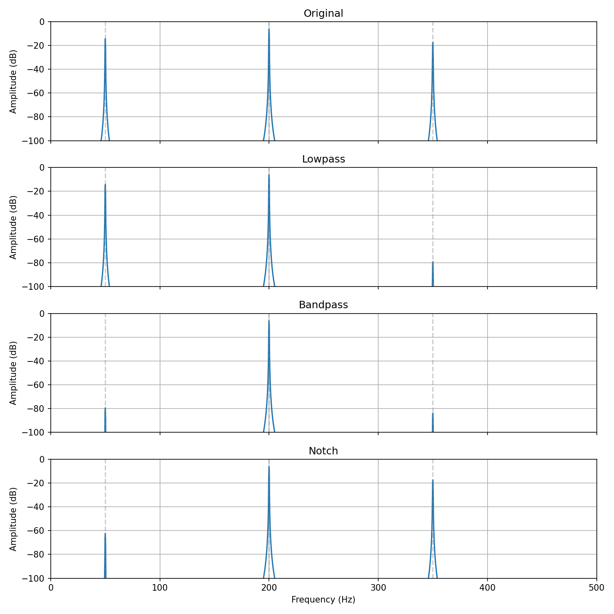
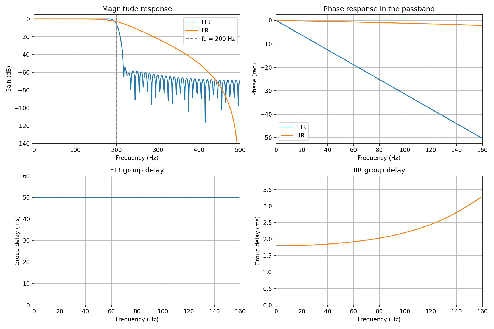

# 滤波器选型与 FIR/IIR 对比报告

## 实验范围

当前实验包含合成三音信号的滤波，以及一个 101 点 FIR 与四阶 Butterworth IIR 的频响比较。结果证明当前实现的指定行为，不代表真实语音或所有滤波器设计的普遍优劣。

## 三种 FIR 的用途

采样率 1000 Hz，4096 个样本。目标为 200 Hz、幅度 0.5；干扰为 50 Hz、幅度 0.2，以及 350 Hz、幅度 0.15。

| 设计 | 参数 | 预期作用 |
|---|---|---|
| 低通 | fc=250 Hz，101 点 | 保留 50、200 Hz，主要抑制 350 Hz |
| 带通 | 150～250 Hz，101 点 | 保留 200 Hz，同时抑制两侧干扰 |
| 陷波 | f0=50 Hz，q=5 | 主要压低 50 Hz，保留 200、350 Hz |



结论：低通适合去掉目标频带以上的干扰；带通适合已知目标只在一段频率内的情况；陷波适合已知窄带干扰，同时尽量保留其他频率。

由当前系数在三个频率上直接计算的稳态幅度增益如下，单位 dB。这不是从有限长 FFT 图上读取的峰值，也不是总 SNR 改善量。

| 滤波器 | 50 Hz | 200 Hz | 350 Hz |
|---|---:|---:|---:|
| 低通 | −0.009 | +0.007 | −61.751 |
| 带通 | −65.177 | 约 0 | −66.518 |
| 陷波 | −48.101 | +0.001 | +0.001 |

少量正增益来自有限长窗函数设计的通带波动，不应把通带理解为处处严格等于 1。陷波中心为有限衰减，没有强制精确零点。

复现命令，在 dsp-toolbox 目录运行：

```bash
MPLBACKEND=Agg python examples/demo_filter_denoise.py
```

演示默认把图保存到 `outputs/`。本报告展示的图片可用 `--output docs/images/filter_denoise_comparison.png` 重新生成。

## FIR 与 IIR 的幅频和群延迟

共同设置 fs=1000 Hz、fc=200 Hz。FIR 使用 101 点 Hamming 窗低通；IIR 使用四阶 Butterworth。FFT 长度 1024，相位和群延迟只观察 0～160 Hz 通带内部。



| 观察项 | 本例 FIR | 本例 IIR |
|---|---|---|
| 系数 | 101 个 FIR 系数 | 分子、分母各 5 个系数 |
| 200 Hz 的增益 | 约 −6.016 dB | 约 −3.010 dB |
| 0～160 Hz 数值群延迟 | 约 50.000 ms | 约 1.798～3.266 ms |
| 通带相位 | 接近直线 | 非线性 |

当前 IIR 以较少系数取得较小延迟，但不同频率的延迟有所不同；当前 FIR 提供固定群延迟，代价是较大延迟和更多直接卷积乘加。

这不是等通带误差、等阻带衰减约束下的最优设计比较。两种方法对 fc 的定义不同，阶数与系数数量也不同，不能据此断言所有 FIR 或 IIR 谁更陡、更快。两幅群延迟子图纵轴范围不同，应读数值。

```bash
MPLBACKEND=Agg python examples/demo_fir_iir_comparison.py
```

要更新报告图片，运行 `MPLBACKEND=Agg python examples/demo_fir_iir_comparison.py --output docs/images/fir_iir_comparison.png`。

## 选型决策表

| 需求 | 优先考虑 | 需要检查的代价 |
|---|---|---|
| 保留低频、去掉较高频干扰 | 低通 | 目标和干扰之间是否留有足够过渡带 |
| 只关心一个已知目标频带 | 带通 | 带外是否也有需要保留的有效信号 |
| 抑制已知窄带干扰 | 陷波/窄带带阻 | 实际带宽、中心抑制，以及 FIR 长度和延迟 |
| 各频率的相对时序很重要，允许一定延迟 | 对称 FIR | 群延迟、系数数量、计算量 |
| 延迟和算力约束更紧，允许相位非线性 | IIR | 稳定性、群延迟变化、直接型的数值表现 |
| 数据按块到达 | 保存状态的流式 FIR/IIR | 任意分块与整段输出是否一致 |

## 验收与复盘

2026-10-24：共享副本在 Windows Python 3.13.3、NumPy 2.5.4、SciPy 1.18.1、pytest 9.1.1 下，执行 tests 全量回归，552 项通过，21 项 C 用例因未传入 C 库而跳过。

用户已在 Ubuntu 的 audio-learning 环境确认 CTest 的 FIR 对拍通过。C 浮点门槛为 1e-6，分块结果要求与 C 整段处理完全一致。本报告没有记录尚未测量的性能数字、内存泄漏结论或实际最大 C 误差。

本轮卡点：频率响应与信号幅度谱的归一化不同；IIR 反馈符号；复数极点误转实数；块长度与系数数量混淆；C 中系数下标 k 与环形位置 index 的区别；指针地址与整数数量混淆。

后续仍需验收：真实音频去噪、字符串练习三题、周计划中的剩余设计理论和等波纹设计。当前三音实验属于合成数据。后续学习继续按完成项推进。
